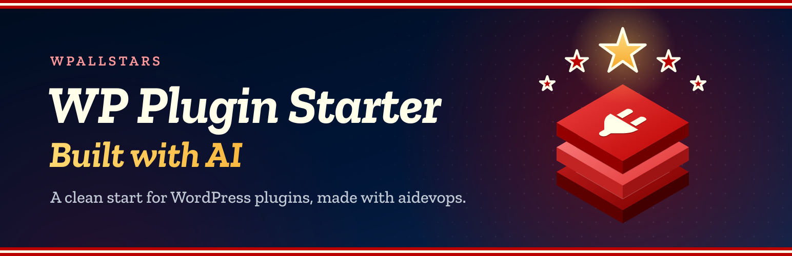
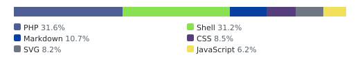
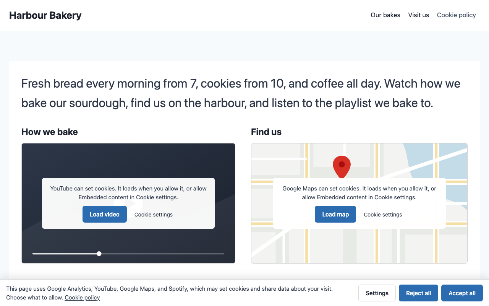
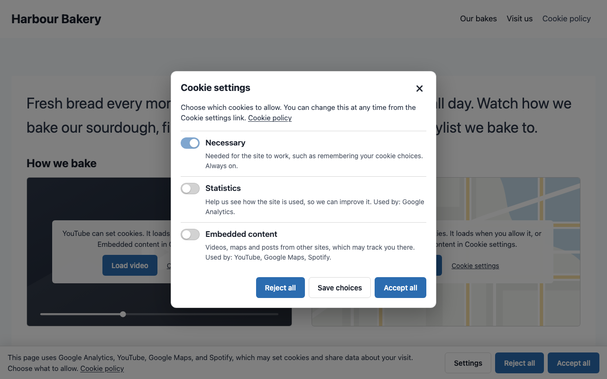
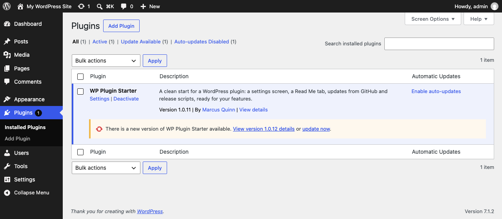

# SEO Pro Cookie Consent

<!-- aidevops:badges:start -->
<!-- On GitHub only: the Read Me tab skips this block. scripts/rename-plugin.sh rewrites it. -->

<!-- aidevops:badges:end -->

Simple, light cookie consent: blocks scripts until consent, asks only where the law and the page need it, and fits your theme.

SEO Pro Cookie Consent is a free cookie consent plugin for WordPress that you switch on rather than set up. It finds the scripts and embeds on your pages that set cookies (Google Analytics, ad pixels, YouTube, maps and more), holds them back until visitors allow them, and shows a short, theme-matched banner only on pages that have them, only as strictly as each visitor's region needs. It replaces Complianz, with nothing to scan, no wizard to finish and nothing sent to outside services.

It is a tool, not legal advice: check its defaults and your policy text with whoever advises you on privacy law.

If this saves you time, headaches and costs, feel free to [buy me a coffee](https://buymeacoffee.com/marcusquinn), or whatever you like, to invest in making more things open-source.

Version: 0.1.2

<!-- github-only:start -->
## Screenshots

**Settings → SEO Pro Cookie Consent**: the General tab, empty until features add settings, with search and the Source code, Support and Buy me a coffee links.

**The Read Me tab** shows this file inside WordPress, banner included.

**Updates from GitHub** (GitHub build): each GitHub release is offered on the Plugins screen as a normal WordPress update.

<!-- github-only:end -->

## What you get

SEO Pro Cookie Consent replaces **15 plugins**, some of them in part, with free and Pro editions counted separately. The 11 that can be downloaded come to 31.6 MB zipped; SEO Pro Cookie Consent is 389 KB.

It replaces the consent features of Complianz, CookieYes, Cookie Notice & Compliance, CookieAdmin, GDPR Cookie Compliance, WPConsent, Real Cookie Banner, Cookiebot, iubenda, Termly, Borlabs Cookie and Ultimate GDPR & CCPA, and provides starting text in place of Complianz Terms & Conditions; review the limits below before switching.

- **Holds back what sets cookies.** Scripts and embeds from Google Analytics, Google Tag Manager, Google Ads, Meta Pixel, TikTok, LinkedIn, Pinterest, Microsoft Clarity and Advertising, Hotjar, HubSpot, X, YouTube, Vimeo, Google Maps, Spotify, SoundCloud, Instagram, Facebook and live chats (Tawk.to, Crisp, Intercom) wait until visitors allow them. Nothing to scan or list by hand: the plugin recognises them in each page as it is sent.
- **Asks only where needed.** No banner on pages with nothing held back. Visitors in Europe (EU, EEA, UK, Switzerland), Quebec, or anywhere their browser does not make clear, are asked before anything loads; everyone else gets the site as usual with a short notice, or no notice at all if you prefer. The browser's time zone decides, so nothing is looked up, nothing is sent anywhere and page caches keep working.
- **A short, fair banner.** Accept all and Reject all look the same, Settings opens a dialog with one switch per kind of cookie, and the message names what is on the page ("This page uses YouTube and Google Analytics…"). A bar along the bottom, or a box at the bottom left or right.
- **Videos and maps with a Load button.** A held-back YouTube video, map or post shows a placeholder the same size, with a button that loads just that one.
- **Catches lightboxes too.** Recognised script and iframe addresses added after page load through common DOM APIs wait for the same consent choice. Keep the consent head script excluded from script-delay optimizers. This is not a network firewall: inline-only injected code, shadow roots and unusual parser APIs need integration with the browser consent API.
- **Local video thumbnails.** YouTube and Vimeo placeholders show a locally stored thumbnail. WP-Cron fetches it once per video, not during a visitor's page request; until it is ready (or if unavailable), the plain placeholder stays. Cached pages show it after their next refresh. No visitor data is sent to the video service for the thumbnail.
- **Fits your theme.** Colours, fonts and buttons come from Kadence's palette, light and dark mode included, or your block theme's colours. Comfortable on phones, keyboard friendly, with real switches and a proper dialog for screen readers.
- **Easy to change your mind.** A Cookie settings link joins your footer menu, just after your cookie policy link or before your privacy policy link, including footer menus shown by widgets. To place it yourself, tick Cookie settings in Appearance → Menus; the automatic link then steps aside. The Cookie settings button block or any link to `#cookie-settings` opens it too, and an optional floating button can show after visitors choose. Taking consent back removes those services' cookies and reloads the page so they stop.
- **Global Privacy Control** turns marketing off where visitors are not asked first.
- **Works with Google and WordPress.** Google Consent Mode v2 signals (denied by default where visitors are asked first) and the WP Consent API, so plugins that read it follow the visitor's choice.
- **Optional consent records.** Keep anonymous choice snapshots on your own site, export them as CSV and delete them automatically after your chosen period, never shorter than the consent lifetime. Off by default; no requests on ordinary page views.
- **A cookie policy that keeps itself current.** The Cookie policy block (or `[spcc_cookie_policy]`) lists the cookies your site uses, by kind, with what each does, how long it is kept and the service's privacy policy, plus the Cookie settings button. The block's settings turn the introduction, the button and the last-updated date on or off and choose the heading level. Write the rest of the page as you like; the list updates itself. Suggested text is added to Settings → Privacy → Policy guide.
- **Shows what it found.** The settings card lists the services found on your pages, and any other third-party scripts that load as usual, so you can hold back one it does not know.
- **Replaces Complianz, CookieYes, Cookie Notice, CookieAdmin, GDPR Cookie Compliance, WPConsent, Real Cookie Banner, Cookiebot, iubenda, Termly, Borlabs Cookie and Ultimate GDPR & CCPA.** The Import tab previews, then imports their settings, script rules, policy pages and, where their format is verified, visitors' explicit choices, with undo and leftover cleanup. While one of them is active this waits, so two banners never show.
- **Terms and conditions without a paid generator.** An optional block or `[spcc_terms]` shortcode turns your business name, country, offering, returns policy and contact details into plain-English starting text. Use your own wording instead if needed. Imports matching identity/contact answers from Complianz Terms & Conditions once, without changing its options or your pages.

For statistics with no cookies and no banner at all, use SEO Pro Stats: it needs no consent, so pages that only use it show no banner.

## Set it up

1. Go to **Settings → SEO Pro Cookie Consent → Consent** and switch on **Cookie consent**.
2. Choose **Scan now** and check **Found on your pages** on the card. It checks the home page, privacy page and up to three recent posts and three pages, without running scripts or contacting the embedded services. This is a sample, not a full audit or a browser scan: services inserted only by JavaScript are not discovered. Pages are also checked as visitors browse. If loopback requests are blocked, open a few pages yourself instead.
3. Optional: switch on **Cookie policy** (Policies tab) and add the Cookie policy block to your privacy policy page, under a "Cookies" heading.
4. Optional: under **Policies → Terms and conditions**, enter your answers, switch the feature on and add the Terms and conditions block (or `[spcc_terms]`) to a page. Review the whole page before publishing.

That is all. **Preview the banner**, at the top of the card's options, shows your home page with the banner as a visitor who is asked first, or one shown a notice, sees it, on a desktop or phone screen; it updates after each change, and choices made in it are not saved. Under Options you can choose who is asked first, where the banner sits, its message, the policy page it links to (start typing a page title to pick one), and whether a floating Cookie settings button shows (off by default; the footer menu link is usually enough). The banner sits above other floating bars; to change its layer, set `--spcc-z` on `:root` in your theme's CSS. Troubleshooting has **Also hold back** (for a script the plugin does not know: part of its address, with `statistics:`, `preferences:` or `embeds:` in front for another kind), **Never hold back**, Google Consent Mode advanced, and how long choices are remembered.

## Multilingual sites

The banner, dialog and placeholders use the page's WordPress translations. With WPML String Translation or Polylang, open the site's admin after enabling consent, then translate `consent_message` and, if needed, `consent_policy_url` in the **SEO Pro Cookie Consent** string group. Saving settings refreshes the registered source strings. An empty message keeps the automatic translated message.

Policy links use the current language's published policy-page translation when available, including the default privacy policy page; otherwise they keep the original link. TranslatePress translates ordinary page output and uses its string translation API for a custom banner message. Supply translations in your multilingual plugin; this plugin does not translate text automatically or bundle language packs. Clear each language's page cache after changing text or translations. Language follows the page, not browser preferences, cookies or IP. Without a multilingual plugin, the saved message and policy link work as before.

## Consent records

Under Consent → Options, turn on **Keep consent records** only if you need a history. Each explicit choice (including Reject, a later withdrawal, a dismissed opt-out notice and a single-service Load) sends one small, best-effort request to your own site. Ordinary page views, automatic regional defaults and banner previews send none. A random anonymous ID in the consent cookie joins a visitor's choices until the cookie expires or is removed. No IP address, user agent, page URL or WordPress user ID is stored.

Records contain categories, individually allowed services, the choice model, whether the banner still needs an answer, browser choice time, server receipt time, **Policy version** (up to 100 characters), and a **Snapshot** hash. The matching private snapshot archives the banner message templates, button labels, category descriptions and service catalogue, policy URL, local policy page source and modification/revision details, and plugin version: evidence of what was shown. Identical content shares one SHA-256 hash; changing the banner message or saving the policy creates a new snapshot only when its content changes. Settings/admin work creates snapshots, never visitor requests. This does not ask visitors again on a version change. Clear page caches after changing settings, policy text or translations.

Snapshots describe the available wording and services, not the exact page-specific list or final regional message a browser rendered. An old cached page can still submit its known older hash. Missing, malformed or unknown hashes are stored as empty without losing the choice. A translated or filtered presentation not yet archived by admin work also sends an empty hash, never a hash for different wording. External policy URLs have no local page source or revision; keep those documents separately. Local page source does not freeze external embeds or dynamically rendered blocks.

**Keep records for (days)** sets how long you need evidence of consent, up to 3,650 days. The default **0** follows **Remember choices for (days)**, as before. A positive value keeps records for the longer of the two periods, never less than the choice lifetime; for example, 1,095 keeps evidence for three years without remembering visitors' choices for longer. Choose the period appropriate for your site and explain it in your privacy policy.

Reload the settings screen after enabling to see **Export consent records (CSV)** and **Export consent snapshots (CSV)**. Join the exports by their Snapshot column; snapshot content is JSON in one spreadsheet cell. Only site administrators can export. Record exports omit expired records and protect spreadsheet formula prefixes; snapshot text stays inside a JSON object, not an executable cell. Treat the ID and exports as potentially personal data and include this processing in your privacy policy. WordPress's hourly cron deletes expired records in batches of 1,000, even after recording is switched off; deletion depends on WP-Cron running and busy sites may take several batches. Archived snapshots are retained until uninstall, so cleanup can never remove content a kept record points to. Uninstall removes both tables and the cleanup event on every site in a network.

These are self-reported snapshots, not authenticated identity evidence or a guarantee of legal compliance. Delivery can fail (offline, blocked REST, unavailable storage or browser support); no retry or recording-success claim is made. Browsers without secure random generation or `sendBeacon` still save consent locally, but send no record. The write-only public route accepts bounded JSON from the site's origin; it is not protection against bots forging requests. Use your host's request limits for abuse protection. Each multisite site has separate storage and exports.

## Terms and conditions

This feature is off by default and independent of Cookie consent. Fill in your legal business or owner name and public contact details before using the suggested wording; it stays empty for visitors until both are present. Country identifies where you are based, not a choice of governing law. Describe what you offer, payment and delivery terms where relevant, and your returns, refunds and cancellation process. No return period or country-specific legal clause is assumed. Empty optional answers omit their sections.

The block and shortcode read current settings on every render. After changing answers, clear any full-page cache to update cached copies. **Your own wording** replaces all suggested text with plain text, one paragraph per line; HTML and shortcodes are not executed. Normal blocks around it remain yours to edit.

On upgrade, the plugin imports only unset business name, country and the selected email/contact-page answer from Complianz Terms & Conditions. Review imported country codes and complete the other answers yourself. It never enables Terms for you, changes the old plugin's options, or converts its blocks, shortcodes, documents or withdrawal forms on its own. While that plugin is active, Terms waits. Review your replacement page and any required withdrawal process before deactivating it, then replace its block or shortcode with this one, or keep the old document as editable HTML from the Import tab.

The wording is a starting point, **not legal advice** or a guarantee of compliance. Have someone qualified for your business and jurisdictions review it, including consumer rights, sales disclosures and any required online withdrawal process. This feature does not provide checkout acceptance or a withdrawal form.

## Move from Complianz

Open **Settings → SEO Pro Cookie Consent → Import**. It finds Complianz data even when the plugin is inactive or deleted, and shows a dry run before anything changes.

- **Settings**: region handling, consent lifetime, Google Consent Mode, the default banner's position and message, and the cookie policy link. Only settings still at their defaults are filled in. When Complianz asked visitors elsewhere with an opt-in banner (EU, UK, South Africa or Brazil), everyone is asked first here too.
- **Script rules**: enabled custom blocked and allowed URLs are added to **Also hold back** and **Never hold back**. Inline "add script" entries are not imported.
- **Pages**, each only when you select it, with a saved revision: cookie policies become the Cookie policy block (and Cookie policy is turned on, so it shows), Manage consent and revoke links become the Cookie settings button, a document you unlinked and edited keeps your text as editable HTML, and generated documents are kept as rendered HTML. Generated documents need Complianz active to render; a blank document is never saved. Forms (data requests, Do Not Sell) and live lists are listed for you to replace.
- **Visitors' choices**: a visitor who chose categories in Complianz keeps them; only dismissing the banner is not consent. Carry-over starts once Complianz is inactive.

**Continue consent records:** when Complianz Premium's local records table has rows, the dry run includes **Keep consent records: on**, and importing turns it on. The same applies to local consent tables left by Borlabs Cookie, Ultimate GDPR & CCPA, Real Cookie Banner, CookieAdmin and WPConsent, even if their settings are gone. Only the existence of a row is checked; old records are never read or copied. Empty or missing tables, data requests and Real Cookie Banner's revisions alone do not enable recording. Hosted providers leave the setting unchanged. Undo restores the previous setting through the normal changed-since-import checks; importing again without changes does nothing. Review your privacy policy and purge page caches when switching.

Each import can be undone while its values and pages are unchanged. After checking the banner and pages, deactivate and delete Complianz, then use **Remove leftover data** to delete exactly the listed options, tables, scheduled events, post meta (scan markers and the per-page hide-banner setting) and the folders it generates in `uploads/complianz` (vendor lists, banner CSS, placeholders, GeoLite database, PDF font cache), never while Complianz is active. Its records of consent and data requests, and any other `uploads/complianz` folder such as proof-of-consent snapshots, are listed but kept; export them first if you must keep them. Check Complianz's own delete-data-on-uninstall setting first, and purge page caches after switching. The same steps run with WP-CLI: `wp seoprocookieconsent migrate plan|import|undo|cleanup complianz` (`--pages=ID,ID`, `--dry-run`).

Until Complianz and its data are gone, the Plugins screen (a notice at the top and a note under each Complianz row) and this plugin's settings screen show the next step, with a link:

| Step | When | Links |
|---|---|---|
| Import | Complianz is active and nothing is imported, or it is inactive or deleted with its settings still here (pages that show its documents may already be blank) | **Import from Complianz** |
| Switch | Imported, Complianz still active | **Check the import**, **Turn on Cookie consent** when it is off, then **Deactivate** |
| Remove | Complianz is inactive or deleted and left data | **Delete Complianz** (single sites), **Remove leftover data** |

Only people who can activate plugins see these. **Hide** hides the current step for you; it shows again at the next step. The Plugins screen then leaves out its usual "can do the job of these plugins" line for Complianz, so it never says to deactivate before importing.

## Move from CookieYes or Cookie Notice

The same Import tab, WP-CLI command (`cookieyes`, `cookie-notice`), undo, Move here steps and leftover cleanup work for CookieYes (`cookie-law-info`, checked against 3.5.7) and Cookie Notice & Compliance (`cookie-notice`, checked against 3.1.17). Only data stored on your site is read. Neither plugin keeps records of consent on the site, so cleanup has none to keep.

**CookieYes**

- **Settings** from its default banner: a GDPR banner asks everyone first; consent lifetime, position (box bottom left/right, or bar), a changed message and the Read more link. A CCPA banner is imported without carrying choices over.
- **Script rules**: each cookie with a script URL pattern becomes an **Also hold back** line in its category (Functional → preferences, Analytics and Performance → statistics, Advertisement and custom categories → marketing).
- **Pages**: `[cookie_audit]` becomes the Cookie policy block, `[cookie_settings]` and `[wt_cli_manage_consent]` the Cookie settings button. `[cookie_after_accept]` blocks, the CCPA opt-out link and other legacy shortcodes are listed for you to replace.
- **Visitors' choices**: Accept all, Reject all and a saved selection carry over, by category. Its dialog has switches only for categories with listed cookies, so those decide; the others follow Accept all or Reject all. Closing the banner counts as Reject all, and a cookie that is neither a clear consent nor a full rejection is ignored, so that visitor is asked again.
- **Not imported**: sites connected to the CookieYes web app (banner, categories and scripts live there) and its legacy version 2 mode. The Import tab says so; visitors are asked again. Scripts you marked for CookieYes in your theme (`data-cookieyes` with `type="text/plain"`) stay off once it is gone: remove those two attributes so this plugin holds them back instead.

**Cookie Notice & Compliance**

- **Settings**: consent lifetime (1, 3 or 6 months, or a year), a bottom bar, a changed message and the privacy policy link. Sites with "after acceptance" scripts ask everyone first.
- **Script rules**: addresses in its after-acceptance scripts (head and body) become **Also hold back** lines. Inline scripts with no address are listed for you to add by hand. Cookie Notice ran those scripts itself, so they stop when it is gone: add them to your theme or a header-code plugin, and this plugin holds them back. Copy them before removing leftover data; if Cookie Notice's Deactivation option is on, it deletes them when deactivated.
- **Pages**: `[cookies_revoke]` becomes the Cookie settings button. `[cookies_accepted]` blocks and `[cookies_policy_link]` are listed for you to replace.
- **Visitors' choices**: Accept allows every category; Reject and its close button allow none. When it accepted on scroll or click, only rejections carry over.
- **Not imported**: Cookie Compliance (hosted) mode, where the banner and choices live in its web app. The Import tab says so; visitors are asked again.

A shortcode that sat inside a paragraph becomes `[spcc_cookie_settings]` or `[spcc_cookie_policy]`, so the paragraph stays valid; on its own it becomes the block.

## Move from CookieAdmin, GDPR Cookie Compliance or WPConsent

The same Import tab, WP-CLI command (`cookieadmin`, `gdpr-cookie-compliance`, `wpconsent`), undo, Move here steps and leftover cleanup work for CookieAdmin (`cookieadmin`, checked against 1.2.6), GDPR Cookie Compliance by Moove (`gdpr-cookie-compliance`, checked against 5.2.2) and WPConsent (`wpconsent-cookies-banner-privacy-suite`, checked against 1.2.0). Only data stored on your site is read. Their Pro add-ons were not checked: geolocation, custom scripts and consent logs from them are not imported.

**CookieAdmin**

- **Settings**: its GDPR law asks everyone first (unless Pro showed the banner only in some regions); consent lifetime, position (box bottom left/right, or footer bar), a changed message and the cookie policy link.
- **Script rules**: each cookie in its list with a script pattern becomes an **Also hold back** line in its category (Functional → preferences, Analytics → statistics, Marketing and unclassified → marketing).
- **Visitors' choices**: Accept all, Reject all and saved preferences carry over; embeds follow Marketing. Only its GDPR law carries choices over: with US state laws (opt-out) or a Pro law, visitors are asked again.
- Scripts you marked for CookieAdmin in your theme (`type="text/plain"` with `data-cookieadmin-category`) stay off once it is gone: remove those two attributes so this plugin holds them back instead.

**GDPR Cookie Compliance (Moove)**

- **Settings** are read from its own settings table, even while it is inactive: everyone is asked first unless categories were on before visitors chose; consent lifetime, position (bottom bar, or bottom left/right box) and a changed message in the site's main language.
- **Script rules**: addresses in the scripts of its enabled categories become **Also hold back** lines; inline scripts with no address are listed for you to add by hand. It added those scripts itself, so they stop when it is gone: add them to your theme or a header-code plugin, and this plugin holds them back. Its built-in integrations (Google Analytics 4, Tag Manager, Ads, Meta Pixel, Microsoft) are listed with their IDs to add back the same way.
- **Visitors' choices**: its categories hold whatever you put in them, so a choice carries over only when every switchable category agrees; a mixed choice carries over as Reject all. When its close button accepted all cookies, or categories were on before visitors chose, only rejections carry over. If its add-on accepted on scroll or after a timer, choose **Stop carrying over old consent**: those look the same as Accept.
- **Pages**: it has no page shortcodes to convert.

**WPConsent**

- **Settings**: its default opt-in banner asks everyone first; consent lifetime, bottom bar or bottom left/right box, a changed message and its cookie policy page.
- **Script rules**: none to import; it blocked its own list of known services, which this plugin recognises too.
- **Pages**: `[wpconsent_cookie_policy]` becomes the Cookie policy block and `[wpconsent_preferences_button]` the Cookie settings button. Links with its `wpconsent-open-preferences` class are listed: point them at `#cookie-settings` instead.
- **Visitors' choices**: its Statistics and Marketing choices carry over; embeds follow Marketing, and preferences need both. A visitor who only pressed Load on one embed, or chose only some services, is asked again. Closing its banner saves nothing.
- **Cleanup** keeps its consent logs and Do Not Track requests. Its cookie list (posts and categories) is not removed: WPConsent deletes it on uninstall when its own delete-data option is on.

## Move from Real Cookie Banner

The same Import tab, WP-CLI command (`real-cookie-banner`), undo, Move here steps and leftover cleanup work for Real Cookie Banner and Real Cookie Banner Pro (`real-cookie-banner`, `real-cookie-banner-pro`, both checked against 5.4.0). Only data stored on your site is read.

- **Settings**: an active banner asks everyone first; consent lifetime, a bottom bar or bottom left/right dialog, and its cookie policy page. Its banner texts are not imported: they describe its own dialog, and the message here names what each page uses.
- **Script rules**: addresses that its services' opt-in code loads, and plain address rules of its content blockers, become **Also hold back** lines in the service's category (recognised services by template; otherwise Statistics, Marketing, or functional groups as preferences). Rules with inner wildcards and element selectors are left for you. It ran its services' code itself, so that code stops when it is gone: the Import tab lists those services; add any code you still need to your theme or a header-code plugin, and this plugin holds it back.
- **Pages**: `[rcb-cookie-policy]` becomes the Cookie policy block, and `[rcb-consent]` change and revoke links the Cookie settings button. History links, `[rcb-consent-history-uuids]` and `#consent-…` links are listed for you to replace. Menu links to `#consent-change`, `#consent-history` or `#consent-revoke` are reported: point them at `#cookie-settings`.
- **Visitors' choices**: Accept all, Continue without consent, saved individual choices, a content blocker's Load and a revoke carry over. Visitors could accept single services, so a category is allowed only when every Real Cookie Banner service in it was accepted; one with none of its own follows them all. Closing its banner with the close icon, country bypass and bot or Do Not Track choices are not carried over, so those visitors are asked again.
- **Not imported**: Pro's TCF, Google Consent Mode, country bypass, consent forwarding and banner-less consent. The Import tab names any that were on; while country bypass or banner-less consent is on, visitors are asked again.
- **Cleanup** removes its settings, services, content blockers, banner links, groups and its scan, template and statistics tables. Its consent records and the revisions they refer to are listed but kept. Deleting the plugin removes only its copied script files. When local consent rows exist, the import turns on **Keep consent records** to continue documenting choices.

## Move from Cookiebot, iubenda or Termly

The same Import tab, WP-CLI command (`cookiebot`, `iubenda`, `termly`), undo, Move here steps and leftover cleanup work for Cookiebot by Usercentrics (`cookiebot`, checked against 4.7.5), iubenda (`iubenda-cookie-law-solution`, 3.13.5) and Termly (`uk-cookie-consent`, 3.3.1). Their banners, categories, texts, cookie scans and consent records live in their web apps. The import never contacts them or asks for an account: it reads only what their plugins saved on your site.

- **What stays behind**: the Import tab says which dashboard settings were not imported, and lists the services this plugin found on your pages to compare with their cookie scan. Add anything missing under **Also hold back**. Export any consent records you must keep from their dashboard before closing the account, and turn on **Keep consent records** to go on documenting choices.
- **Visitors' choices are not carried over**: their hosted scripts write the consent cookies, and those formats were not checked against a live account, so visitors are asked again once.
- **Cookiebot**: its "ignore scripts" list becomes **Never hold back** lines, except for services this plugin recognises. Google Tag Manager that Cookiebot loaded, Google Consent Mode, TCF, CCPA, region banners, add-ons and its WPForms add-on (which turned off WPForms' GDPR settings) are reported. `[cookie_declaration]`, `[uc_embedding]`, its Cookie declaration block and `cd.js` script become the Cookie policy block; links and buttons calling `Cookiebot.renew()` or `Cookiebot.show()` open Cookie settings. Scripts marked `data-cookieconsent` and the declaration widget are listed for you to change.
- **iubenda**: its simplified set-up (not pasted code) asks everyone first when it did, and sets a bottom left/right box position. Custom script and iframe patterns become **Also hold back** lines by purpose (strictly necessary ones **Never hold back**). `[iub-cookie-block]` content stays with its tags removed and its addresses held back here; `[iub-cookie-skip]` content stays as is. Its hosted cookie policy embed becomes the Cookie policy block and `iubenda-cs-preferences-link` links open Cookie settings. Other hosted embeds, privacy and terms buttons, the legal block and widget, US/Brazil laws, TCF and its form mapping to its consent database are reported.
- **Termly**: its custom blocking map becomes **Also hold back** lines (advertising → marketing, analytics → statistics, performance → preferences, social → embeds) and **Never hold back** lines for essential addresses. Links calling `displayPreferenceModal()` open Cookie settings. Its policy embeds name a document only by ID, so they are listed for you to replace. A TermlyBot section it may have added to `robots.txt` is reported.
- **Cleanup** removes their options, Cookiebot's widget and add-on settings, iubenda's form mappings and scheduled checks, and Termly's daily account check and its saved API key (by name; the value is never shown).

## Move from Borlabs Cookie or Ultimate GDPR & CCPA

The same Import tab, WP-CLI command (`borlabs-cookie`, `ct-ultimate-gdpr`), undo, Move here steps and leftover cleanup work for Borlabs Cookie (`borlabs-cookie`, checked against 3.4.6 and a running 3.4.6 site) and Ultimate GDPR & CCPA by createIT (`ct-ultimate-gdpr`, checked against 5.4.0). Both are sold outside WordPress.org. Only data stored on your site is read, also while they are inactive or deleted, and no code of theirs is used.

- **Visitors' choices are not carried over**: neither cookie format could be fully checked (Borlabs Cookie's validity depends on a cookie version), so visitors are asked again once.
- **Borlabs Cookie settings**: its dialog asks everyone first when it was on, out of setup mode and shown to everyone (not with geo-IP or hidden pages); cookie lifetime, a bottom bar or bottom left/right box, and its privacy page or link. Its settings are read as plain data, never as its classes. Dialog texts are not imported.
- **Borlabs Cookie script rules**: addresses its optional services' opt-in code loads, its service locations and its content blocker locations become **Also hold back** lines in the service's category (recognised services by key or code; otherwise its Statistics, Marketing or External Media groups, with unclassified ones as marketing). It ran its services' code itself, so that code stops when it is gone: the Import tab lists those services. Its script blockers match by handle or code and are listed for you.
- **Borlabs Cookie pages**: `[borlabs-cookie type="btn-consent-preferences"]` becomes the Cookie settings button and `service-list` or `cookie-list` the Cookie policy block; links with its `borlabs-cookie-open-dialog-preferences` class open Cookie settings. Other types, such as the consent history, are listed. Menu links with that class are reported: point them at `#cookie-settings`.
- **Borlabs Cookie cleanup** removes its settings, services, content blockers, scan, package and other tables, dropping tables others refer to last, and keeps its consent log and statistics. Deleting Borlabs Cookie runs its own uninstall, which removes all its data **including its consent log**: export the records you must keep first. Its generated files in `uploads/borlabs-cookie` are not removed by cleanup.
- **Ultimate GDPR & CCPA settings**: a banner on every page asks everyone first, or only European visitors (**By region, no notice elsewhere**) when its location check was on; a banner on selected pages only leaves **Who is asked first** as it is. Cookie lifetime, a bottom panel or bottom left/right box, and its Read more page or link.
- **Ultimate GDPR & CCPA script rules**: its active services' script keywords that are addresses become **Also hold back** lines by level (functionality → preferences, analytics → statistics, advertising → marketing); other keywords are listed. If it was not set to block cookies, the Import tab says so: here recognised services are held back until visitors agree.
- **Ultimate GDPR & CCPA pages**: `[ultimate_gdpr_cookie_popup]` and `[block_cookies]` become the Cookie settings button and `[render_cookies_list]` the Cookie policy block. Its privacy request forms, age gate, terms and policy acceptance boxes, content protection and TCF shortcodes are not cookie consent: they are listed, not replaced, and stop working when it is removed.
- **Ultimate GDPR & CCPA cleanup** removes its settings, services and scheduled scans, and keeps its consent log table and consents saved on user accounts. Deleting it removes only its files. If its cookie scanner left its hidden `gdpr-dummy@createit.pl` user behind, the Import tab says so: delete that user.

## Where to find it

Go to **Settings → SEO Pro Cookie Consent**. The screen has two groups of tabs:

- **Settings**: Consent and Policies. Changes save instantly; there is no Save button. **Search features** (next to the plugin name) finds settings on every tab.
- **About**: this Read Me.

On a multisite network, super admins also have **Network Admin → Settings → SEO Pro Cookie Consent** (Multisite below).

At the top right of the screen, **Source code** opens the plugin’s [GitHub repository](https://github.com/wpallstars/seoprocookieconsent) in a new tab, and **Support** opens its [GitHub issues](https://github.com/wpallstars/seoprocookieconsent/issues) in a new tab. Say what you did, what you expected and what happened, with the versions of WordPress, PHP and SEO Pro Cookie Consent. Leave out passwords, licence keys and personal data, since issues are public. For questions, ask [aidevops](https://aidevops.sh) (Built with AI below). **Buy me a coffee**, next to it, opens the maker’s [Buy Me a Coffee](https://buymeacoffee.com/marcusquinn) page in a new tab.

## Multisite

On a multisite network, **Network Admin → Settings → SEO Pro Cookie Consent** has the same header, search, tabs and cards as each site's screen, for super admins. Its settings are the network's own, kept apart from each site's:

- **New sites start with them**, and so does a site where SEO Pro Cookie Consent runs for the first time.
- **Apply to every site**, under each card, makes every site use the card's network settings. Each site's screen shows the card locked, saying the network administrator sets it, with a link to the network screen for super admins. Switch it off and each site has its own settings again: they are never overwritten.
- Under each card, the sites whose own settings differ, up to 10 named with links to their settings, and **Make every site the same**, which copies the card's network settings into every site's own settings once. Sites can change them again afterwards, unless the card is applied to every site. Networks of more than 500 sites are not compared, and Make every site the same is not offered there.
- When the network changes a site's settings, the site does what saving them there would do (schedules, rules, files) on its next admin screen, cron run or WP-CLI command, never on a visitor's page.
- Settings that only make sense on each site, such as Media Library pictures, are not on the network screen.

## Requirements

- WordPress 6.2 or later
- PHP 7.4 or later

## Updates and releases

There are two builds of each version:

- **GitHub release** (`seoprocookieconsent-X.Y.Z.zip` on the repository’s Releases page): everything, including the shared updater in `includes/github-updater/`, so sites get each release as a normal update. Its main file also gets an `Update URI` header on github.com, so WordPress.org never offers a plugin of the same name in its place.
- **WordPress.org**: the same files without the updater (listed in `.distignore-wporg`) and without the `GitHub Plugin URI`, `Primary Branch`, `Release Asset` and `Update URI` header lines, because plugins hosted there may not install or update code from elsewhere.

The updater waits while Git Updater is active, so the two never both update a plugin.

GitHub releases are the stable beta channel: each version is released there first. WordPress.org gets a version 30 days later, once it has been used on real sites, except security releases, which go to WordPress.org at once. The WordPress.org build has no affiliate links: those listed in `.wporg-links` are replaced by plain ones when it is built.

Releasing on GitHub:

1. Merge the version change (`Version:` and `SEOPROCOOKIECONSENT_VERSION` in `seoprocookieconsent.php`, `Stable tag:` in `readme.txt`, `Version:` near the top of this file) to `main`.
2. Straight away, tag that commit `vX.Y.Z` and push the tag. The Release workflow (`.github/workflows/release.yml`) builds `seoprocookieconsent-X.Y.Z.zip` from the tag with `scripts/build-release.sh` (`.distignore` applied, everything inside a `seoprocookieconsent/` folder), checks it with `scripts/preflight-release.sh` and publishes the GitHub release with it attached; in a public repository it also attaches signed build provenance, which `gh attestation verify` checks. Sites pick the latest release whose tag is a plain version number and the asset named exactly `seoprocookieconsent-X.Y.Z.zip`, so never attach the WordPress.org zip. Full steps: `RELEASING.md`.
3. Sites offer the update when they next check (within 12 hours, or at once with **Check again** on the Updates screen).

Mark test builds as pre-releases on GitHub (or tag them with letters, such as `v1.2.0-rc1`): sites never offer those. Do not add an `Update URI` header to the plugin file in Git: WordPress.org rejects it. The build adds it to the GitHub zip only.

## External services

While Cookie consent is on, WP-Cron requests YouTube thumbnails from `i.ytimg.com` and Vimeo thumbnail metadata from `vimeo.com`, then images from `i.vimeocdn.com`, only for videos embedded on the site. Requests contain the video ID and the server's IP address, not visitor cookies, IP addresses or page URLs. Images are cached in the site's uploads directory and failed requests wait a day before retrying. The browser receives only a same-host image URL; external upload/CDN URLs are not used before consent. These requests are part of the enabled cookie-consent feature; disabling it stops new downloads.

## Developers

A feature is a class in `includes/features/class-seoprocookieconsent-{name}.php` that extends `SEOProCookieConsent_Feature`, listed in `SEOProCookieConsent_Setup::FEATURES`. It declares its settings in `settings()`, adds its hooks in `boot()` (returning early unless `self::enabled()`), and can import another plugin’s settings once in `migrate()` with `self::import_setting()`. Anything only this plugin needs goes in `SEOProCookieConsent_Setup` (`includes/class-seoprocookieconsent-setup.php`): features, settings tabs, header links, settings version, `MENU_PARENT` (its own top-level menu, if any, which then holds the settings screen as **Settings**) and its own helpers. Link to the settings screen with `SEOProCookieConsent_Admin_Manager::page_url()` or `tab_url()`. A screen of the plugin's own shows the settings screen's header: call `SEOProCookieConsent_Admin_Manager::enqueue_header()` on `admin_enqueue_scripts`, then print `
`, `SEOProCookieConsent_Admin_Manager::render_header()`, `
` and the screen's content in `
`; sections go between the last two as the settings screen's tabs (`<nav class="spcc-nav">` with `<a class="spcc-nav__tab">` links, the one shown `is-active`), and `SEOProCookieConsent_Admin_Page::title_section( 'Section name' )` on the screen's `load-{hook}` action puts the section shown after the screen's name in the browser title, as the settings screen does for its tabs. `admin/css/seoprocookieconsent-header.css` styles only those and the header, so the content keeps its styles. The other files in `includes/` and `admin/` are the starter’s core files: `STANDARDS.md` → Structure.

How consent works inside (holding back, regions, the consent cookie and signals): `docs/architecture.md` in the repository.

### Consent automation contract

Banner-answering tools can use the real controls, without a separate consent-setting API. These hooks are stable across translations and visual changes:

| Purpose | Selector |
| --- | --- |
| Active banner | `#spcc-banner:not([hidden])` (also check visibility) |
| Open settings | `#spcc-dialog[open]` (also check visibility) |
| Open the dialog | Visible banner button `[data-spcc-action="settings"]` |
| Explicit allow / refuse | `[data-spcc-action="accept"]` / `[data-spcc-action="reject"]` in the active banner or dialog |
| Save category choices | `#spcc-dialog[open] [data-spcc-action="save"]` |
| Category switches | `#spcc-dialog input[data-spcc-toggle="preferences"]`, `statistics`, `marketing`, `embeds` |

Only interact with the visible prompt, not the persistent footer link or hidden banner controls. A regional opt-out notice's OK button is a dismissal, not Accept all: open Settings and use the dialog's explicit controls instead. Category rows not used on the site are hidden, but their switches remain in the DOM; set all four optional switches to the desired state before Save (a DOM click works on a hidden checkbox). Necessary is always checked and disabled. Escape, the close button and backdrop do not save a choice.

Explicit refusal, acceptance and Save all use the normal save path (`spcc_consent.m: "opt-in"`, even in an opt-out region), blocker, consent signals and optional records. We do not attempt to detect or label automated answers: synthetic clicks are not reliable attribution, and storing browser/extension fingerprints adds no trustworthy evidence. Records remain self-reported choices, not proof of who clicked. No changes to regional defaults or legal guarantees.

Draft rules for DuckDuckGo autoconsent and Consent-O-Matic, their category mapping, test results and upstream submission status are in `docs/consent-automation/` in the repository. Drafts here do not mean released browsers already include them.

Consent filters and browser API:

- `seoprocookieconsent_services`: add or change the services held back and listed in the cookie policy (ID => `name`, `category` of preferences, statistics, embeds or marketing, `patterns` found in a script's or iframe's address or an inline script, `privacy` link, `cookies` as name => purpose and how long, and `embed`, a word for the Load button such as "video").
- `seoprocookieconsent_hold_back`: return false to leave a page's scripts alone (page builders' editing views are skipped already).
- `seoprocookieconsent_front_config`: change what the browser reads; set `model` to `opt-in`, `opt-out` or `quiet` to decide on the server, only on sites without page caching.
- Skip one tag with a `data-spcc-ignore` attribute.
- In the browser: `spcc.has('statistics')`, `spcc.open()` and the `spcc:consent` event on `document` (detail: `categories`, `services`, `model`); Google Tag Manager gets a `spcc_consent_update` event.
- Shortcodes: `[spcc_cookie_policy intro="yes" button="yes" heading="h3" updated="yes"]` (intro, Cookie settings button and last-updated date on unless `no`; heading `h2`, `h3` or `h4`) and `[spcc_cookie_settings label="Cookie settings" style="button"]` (`style="link"` for a plain link); blocks: Cookie policy and Cookie settings button, with the same settings in the block sidebar.
- Blocks with settings: `SEOProCookieConsent_Setup::register_block()` takes `attributes` (each with `type` boolean or string, `default`, `label`, and `options` for a choice or `placeholder` for text); the editor shows them in the block sidebar and the render callback gets them.
- `?spcc_preview=opt-in` or `opt-out` on a front-end page shows the banner as for a first visit to someone who can manage options (the settings screen's preview): nothing is saved or loaded, and links do not navigate.

Filters:

- `seoprocookieconsent_features`: register a feature class that extends `SEOProCookieConsent_Feature`.
- `seoprocookieconsent_settings_schema`: add or change settings. Each entry sets `type` (bool, int, text, url, lines, domains, select, multi, times or media, a picture from the Media Library stored as its attachment ID), `default`, `label`, `description` and either `tab` or `parent`; select and multi also take `options` (an array or a callable, which runs on every settings save, so keep it small: `STANDARDS.md` → Performance) and `open` to keep saved values that are not currently registered. A child setting can take `hidden` (true): it is not shown or searched, for wiring that code sets. A child setting with `group` set to `troubleshooting` is shown last, in a closed **Troubleshooting** section of the panel, for bypasses people need only when something is wrong (`STANDARDS.md` → Code rules); the section opens by itself when one of its settings differs from its default or matches a search. `reload` (true) makes the saved message ask to reload the page, for changes that show only after a page load. `network` (false) leaves a setting off the network screen (multisite), for one that only makes sense on each site, such as a list of the site's own posts or people; media fields and `hidden` wiring are left off already. A multi setting can take `locked` (values, or a callable returning them): choices that are always chosen, shown ticked with a lock, cannot be unticked and are never stored, so the feature itself treats them as chosen. `replaces` (slug => name) shows which plugin a feature replaces; keep that list in the feature's `REPLACES` class constant and pass `self::REPLACES` (`STANDARDS.md` → Structure). Settings render and save automatically.
- `seoprocookieconsent_admin_tabs`: add or reorder admin tabs. Each tab sets `label`, `group` (settings, discover or about), a `render` callback, an optional `capability`, an optional `preload` and an optional `network` (true: also on the network screen, multisite, where its callback runs with `is_network_admin()` true; settings tabs and Read Me have it); tabs the current user lacks the capability for are hidden. The screen draws the active tab with the other tabs of its group that preload (settings tabs and Read Me do), and switches between them without a reload (`SEOProCookieConsent_Admin_Manager::page_tabs()`). Set `preload` to true only when the tab is cheap to draw and its script works while its panel is hidden. An optional `menu` (a name) gathers tabs: tabs of a group with the same `menu` show in the bar as one tab with that name, which opens the first of them, and while one of them is shown, they show as a second row of tabs under the bar (`SEOProCookieConsent_Admin_Page::nav()`).
- `seoprocookieconsent_admin_script_deps` and `seoprocookieconsent_admin_script_data`: the settings screen script’s dependencies (once for each tab drawn on the page) and the data it reads as `seoprocookieconsentAdmin` (with the active tab; `seoprocookieconsentAdmin.tab` follows the tab shown, `tabs` lists the tabs drawn, `titles` their browser titles, and `network` is true on the network screen).
- `seoprocookieconsent_troubleshooting_open`: whether a setting's Troubleshooting section starts open (open, setting key), for a feature that fell back after an error.
- `seoprocookieconsent_can_change_settings`: return false to stop the current user changing SEO Pro Cookie Consent’s settings (on top of `manage_options`).
- `seoprocookieconsent_replaced_plugin_extras`: what a replaced plugin does on this site that SEO Pro Cookie Consent does not (plain names, plugin folder). The Plugins screen names them instead of saying the plugin can go.
- `seoprocookieconsent_stored_active_plugins` and `seoprocookieconsent_plugins_skipped`: for code that skips plugins on some requests, the active plugin files as stored and whether some are skipped on this request, so features still count those plugins as active.
- `wpallstars_github_plugins` (GitHub builds, shared updater): change which plugins update from GitHub releases (plugin file => `repo` as owner/repo, `asset_only`, `version`, `name`).
- `wpallstars_github_token` (GitHub builds, shared updater): GitHub token for a repository (token, owner/repo), for private repositories; defaults to the `WPALLSTARS_GITHUB_TOKEN` constant.
- `wpallstars_github_updater_enabled` and `wpallstars_github_updater_early` (GitHub builds, shared updater): whether it runs (false while Git Updater is active) and whether plugins also on WordPress.org take GitHub releases first.
- `wpallstars_github_updater_checks_in_cron` (GitHub builds, shared updater): return false to let update checks that fall due run on the admin screen being opened, as in core, instead of in WP-Cron.

Actions:

- `seoprocookieconsent_admin_enqueue`: enqueue the plugin’s own admin styles and scripts on its settings screen, depending on `seoprocookieconsent-admin`; it fires once for each tab drawn on the page, the active tab first. Its script can use `seoprocookieconsentAdmin.api` (`post`, `speak`, `errorMessage`), and the `seoprocookieconsent:tab-shown` jQuery event (tab slug) on `document` tells it when another tab is shown.
- `seoprocookieconsent_setting_saved`: a setting was saved from the admin screen (setting key, value), or the network changed it for this site (multisite): then on the site's next admin, cron or WP-CLI request, as nobody, while `SEOProCookieConsent_Network_Sites::syncing()` is true.
- `seoprocookieconsent_settings_changed`: settings changed, however they were saved (the admin screen, presets, WP-CLI, `update_option()`) or by the network for this site, as above (old and new settings, as features read them). Use it rather than `update_option_seoprocookieconsent_options`, which misses the network's changes.
- `seoprocookieconsent_setting_panel`: print status at the top of a setting’s options panel (setting key, schema entry); wrap it in `
`. On the network screen, `seoprocookieconsent_network_setting_panel` fires instead, for notes about the whole network.
- `seoprocookieconsent_settings_tab_after`: print a section after a settings tab’s cards (tab slug). On the network screen, `seoprocookieconsent_network_settings_tab_after` fires instead.

Read a setting with `SEOProCookieConsent_Settings::get( 'key' )`, never the option itself: on multisite it includes the settings the network applies to every site. Code that runs before the plugin loads (a must-use file) reads the network option's `enforced` values (`seoprocookieconsent_network`: card => setting => value) over the site's own, as `SEOProCookieConsent_Settings::all()` does.

## Uninstall

Deleting the plugin removes its settings (on multisite, every site's and the network's), the list of services it found, its cached data, who hid lines of the Plugins screen notice about replaced plugins or Move here steps, its import history, and the cached GitHub releases. It never removes another plugin's data.

## Changelog

### Unreleased

- Stable language-independent consent controls and local draft rules for autoconsent and Consent-O-Matic; automated answers use the same consent and recording path as other choices.
- Imports continue consent recording when local record rows exist for Complianz Premium, Borlabs Cookie, Ultimate GDPR & CCPA, Real Cookie Banner, CookieAdmin or WPConsent. Dry run and undo include the setting; hosted providers and empty tables leave it unchanged.
- A selected page whose newest revision is an old autosave no longer stops the import; the newest saved revision is the undo point.
- An import that puts the Cookie policy block on a page also turns on Cookie policy, which the block needs to show anything; undo turns it off again.

### 0.1.2

- Cookie settings in Appearance → Menus adds a ready-made `#cookie-settings` link. The automatic footer link now sits after the cookie policy link, or before the privacy policy link, and also reaches footer menus shown by widgets; it is skipped once a menu has a saved Cookie settings link.
- Keep consent records for a separate period (up to 3,650 days), never shorter than visitors' choice lifetime. The default 0 keeps the existing retention behaviour.
- Consent records link to deduplicated banner and local policy snapshots, with a separate administrator CSV export: evidence of what was shown. Old cached pages without a known hash still record choices.
- Leftover cleanup after Complianz also removes its post meta and generated `uploads/complianz` folders (other folders are kept), and after Real Cookie Banner its update-checker option.

### 0.1.1

- A video or map a visitor clicks that needs a category they have not allowed, such as a YouTube lightbox (Kadence video popups), now opens Cookie settings with a note naming the service and category, instead of staying blank. Nothing is ticked for them; allowing it loads the video. A second click on the same video asks again; loading a page on its own never opens it.

### 0.1.0

- Import from Complianz on the Import tab or with WP-CLI: dry run, default-only settings, script rules, selected policy pages with revisions, visitors' explicit choices, undo and confirmed leftover cleanup that keeps records of consent.
- Import from CookieYes and Cookie Notice & Compliance in their local modes: banner settings, script rules from CookieYes's cookie list and Cookie Notice's after-acceptance scripts, settings and policy shortcodes in selected pages, and visitors' explicit choices by category; hosted (web app) and legacy modes are reported, not guessed. Source shortcodes inside a paragraph become this plugin's shortcodes instead of invalid nested blocks.
- Import from CookieAdmin, GDPR Cookie Compliance (Moove) and WPConsent: banner settings, script rules, WPConsent's policy and preferences shortcodes, and visitors' explicit choices; Pro add-on behaviour is reported, not guessed.
- Import from Real Cookie Banner and Real Cookie Banner Pro: banner settings, script rules from its services' opt-in code and content blockers, policy and privacy-settings shortcodes, and visitors' explicit service choices mapped to categories; Pro-only features are reported, and cleanup removes its services, blockers and groups but keeps its consent records.
- Import from Cookiebot, iubenda and Termly without contacting their web apps: script rules, iubenda's simplified banner set-up, cookie declarations and policy embeds, preferences links and leftover cleanup; dashboard-only settings are reported and visitors are asked again. A source link or embed inside a paragraph becomes this plugin's shortcode.
- Import from Borlabs Cookie and Ultimate GDPR & CCPA, also while inactive or deleted: banner settings, script rules from their services, settings and cookie-list shortcodes and links in selected pages, and leftover cleanup that keeps their consent logs; visitors are asked again. Ultimate GDPR & CCPA's privacy forms and acceptance boxes are listed, not replaced.
- Move here notices on the Plugins and settings screens: one next step per source, from import through switching to removing leftovers, with links and a per-person Hide.
- Multilingual custom banner messages and policy links with WPML and Polylang, plus TranslatePress custom-text translation.
- Optional consent records: anonymous choice snapshots, policy labels, administrator CSV export and automatic batched retention, with uninstall cleanup.
- Consent card: Scan now samples up to eight public pages, refreshes findings in place and reports blocked loopbacks; a short guide explains the first-run steps.
- Cookie consent: hold back recognised scripts and iframes added after page load, including lightboxes, and update the banner and settings when they appear.
- Optional Terms and conditions block and `[spcc_terms]` shortcode, five owner answers, a plain-text wording override and a one-time non-overwriting import of Complianz Terms & Conditions identity/contact answers.
- Local YouTube and Vimeo thumbnails in held-back video placeholders, fetched in cron without contacting video services from visitors' browsers.
- Cookie consent: holds back scripts and embeds from 23 services until visitors allow them, with a banner only on pages that have them, asking first by region (time zone), Global Privacy Control, Google Consent Mode v2, the WP Consent API, embed placeholders with a Load button, a Cookie settings dialog, footer menu link and button, and a one-off import of Complianz's region and expiry settings.
- Cookie policy block and shortcode that list the cookies the site uses and stay up to date, and suggested privacy policy text.
- Settings screen: a banner preview on the Consent card (home page, asked-first or notice visitor, desktop or phone, updates after each change) and a page picker for the Cookie policy page.
- Blocks: the Cookie policy block's sidebar turns the introduction, Cookie settings button and last-updated date on or off and sets the heading level; the Cookie settings block takes its text and shows as a button or a link. The shortcodes take the same options.
- Cookie consent: the floating Cookie settings button is optional and off by default; the banner shows above floating language switchers and chat buttons; the dialog's close button and the banner buttons keep their colours on hover and focus in themes that style every button.
- First version, made from WP Plugin Starter 1.0.39.

## Built with AI

SEO Pro Cookie Consent is built and maintained with [aidevops](https://aidevops.sh), the same developer's open-source AI harness for creating and managing anything online with AI, plugins like this one included. It is free on [GitHub](https://github.com/marcusquinn/aidevops).

Questions about using, changing or building on SEO Pro Cookie Consent: ask aidevops. Open this repository, or the site it runs on, with aidevops and ask; it reads the plugin's docs and code to answer, and can report a problem for you.

Made from [WP Plugin Starter](https://github.com/wpallstars/wp-plugin-starter-template-for-ai-coding), the wpallstars starter plugin. Its shared standards and the weekly Starter sync keep this plugin up to date.

Works well with [SEO Pro Stack](https://github.com/wpallstars/seoprostack), the wpallstars base plugin for every site: it speeds WordPress up and keeps the admin organised, each job a switch you turn on.

## License

GPL-3.0-or-later (the full text is in `LICENSE`), with the additional terms in `ATTRIBUTION.txt` (GPL-3.0 section 7(b)): keep the copyright notices and the "Made from" credit.

Copying, renaming or adapting this plugin or part of it, by hand or with an AI assistant: read `ATTRIBUTION.txt` first. It says what every copy keeps, with a section for AI assistants.

Copyright (C) 2026 Marcus Quinn

Parts copyright (C) 2026 Marcus Quinn, from [WP Plugin Starter](https://github.com/wpallstars/wp-plugin-starter-template-for-ai-coding).
